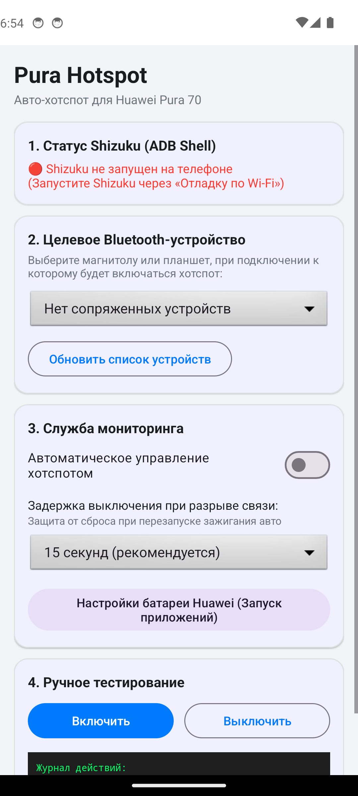

# Pura Hotspot (Huawei Auto Hotspot)

<p align="center">
  
</p>

[📥 Скачать готовый APK (Релиз v1.0.0)](https://github.com/C0dece/PuraHotspot/releases/download/v1.0.0/PuraHotspot.apk)

Легковесная автономная утилита для **Huawei Pura 70** (EMUI 14.2 / HarmonyOS), которая автоматически:
1. **Включает личную точку доступа (Wi-Fi Hotspot)** при подключении к выбранному Bluetooth-устройству (например, автомагнитоле).
2. **Выключает точку доступа** при отключении от Bluetooth с настраиваемой задержкой (защита от кратковременных обрывов при перезапуске зажигания).
3. **Работает тихо и мгновенно** в фоновом режиме через Shizuku (ADB Shell) даже при выключенном экране и заблокированном телефоне в кармане.

---

## Преимущества перед MacroDroid на EMUI / HarmonyOS

- **Не засыпает**: используется постоянный `Foreground Service` (тип `connectedDevice`) с регистрацией ресивера в памяти и `START_STICKY`.
- **Защита процессора (`WakeLock`)**: при приходе Bluetooth-события процессор удерживается от сна на время отправки системной команды.
- **Тихое переключение без всплывающего экрана**: команды точки доступа выполняются напрямую через ADB-интерфейс (`cmd wifi start-softap` / `cmd connectivity start-tethering wifi`), а не через медленную симуляцию кликов по интерфейсу.
- **Защита от дребезга (Debounce)**: если зажигание машины выключилось и сразу включилось, утилита не будет судорожно выключать и включать хотспот, а подождет заданное время (15–30 сек).
- **100% бесплатно и без ограничений на количество правил**.

---

## Как собрать APK

Проект создан по стандартам Android Gradle (Kotlin, AndroidX, Material 3, Shizuku API).

### Вариант 1: Через Android Studio
1. Откройте папку проекта `d:\Dev\Projects\Tools\AndroidHuaweiCommands` в Android Studio.
2. Дождитесь синхронизации Gradle.
3. Выберите меню: **Build -> Build Bundle(s) / APK(s) -> Build APK(s)**.
4. Готовый APK появится в `app/build/outputs/apk/debug/app-debug.apk`.

### Вариант 2: Через командную строку (Gradle)
Если установлен JDK 17+:
```bash
./gradlew assembleDebug
```

---

## Настройка на Huawei Pura 70

### Шаг 1. Установка и запуск Shizuku (один раз)
1. Установите приложение **Shizuku** (из F-Droid, GitHub или Petal Search).
2. На телефоне откройте *Настройки -> О телефоне* и нажмите 7 раз на *«Номер сборки»*, чтобы открыть *«Для разработчиков»*.
3. В меню *«Для разработчиков»* включите:
   - **Отладка по USB**
   - **Отладка по Wi-Fi**
4. Откройте Shizuku -> выберите **«Запуск через отладку по беспроводной сети»** -> спарьте код из шторки.
5. Shizuku запустится и будет работать до следующей перезагрузки телефона.

### Шаг 2. Настройка Pura Hotspot
1. Установите и запустите приложение **Pura Hotspot**.
2. В первой карточке нажмите **«Запросить разрешение Shizuku»** -> выберите «Разрешить всегда».
3. Разрешите доступ к Bluetooth и уведомлениям.
4. Во 2-й карточке выберите вашу автомагнитолу / планшет из выпадающего списка.
5. Задайте задержку выключения (рекомендуется **15 секунд**).
6. Включите тумблер **«Автоматическое управление хотспотом»**.

### Шаг 3. Защита от выгрузки системой Huawei (КРИТИЧНО)
1. Нажмите в приложении кнопку **«Настройки батареи Huawei»** (или перейдите в *Настройки телефона -> Батарея -> Запуск приложений*).
2. Найдите в списке **Pura Hotspot**.
3. Переключите тумблер с «Автоматически» на **«Вручную»**.
4. Убедитесь, что включены все 3 пункта:
   - ✅ **Автозапуск**
   - ✅ **Косвенный запуск**
   - ✅ **Работа в фоновом режиме**

---

## Архитектура для будущего расширения («Mini MacroDroid»)

Проект спроектирован модульно:
- `ShizukuManager.kt` — универсальный исполнитель любых shell-команд (переключение режимов, яркость, Wi-Fi, мобильные данные, запуск активности).
- `HotspotController.kt` — пример модуля действия (Action). Сюда можно добавить `BluetoothController`, `VolumeController`, `AppLauncher`.
- `BluetoothReceiver.kt` — пример триггера (Trigger). Легко расширяется на триггеры заряда батареи (`ACTION_POWER_CONNECTED`), Wi-Fi сетей (`NETWORK_STATE_CHANGED_ACTION`) и геолокации.
